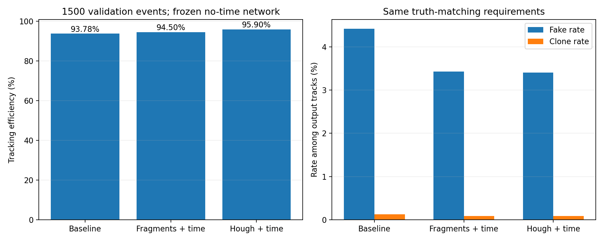

# 片段回收与Hough按顺序验证

> 历史模拟报告：2026-10-15新增实验反馈确认精确模拟时间不可直接取得。本文数值不变，time及时间回收仅作理想时间对照；适用结论以[测量口径更新](../../docs/MEASUREMENT_UPDATE_20261015.md)为准。

2026-10-14。第62轮no-time权重固定，0.70/0.575两级阈值、匹配纯度0.8/完整度0.5均未改变。

203个验证事件用于选择，1297个验证事件用于内部确认；模型训练期间用过整个验证组，不能把该确认组宣称为新的独立测试。独立1500测试事件未使用。

回收只读取观测量，不读取TrkID、t0、d_true、边标签；时间代理为观测t减去测量d/漂移速度。新增时间约束是额外后处理信息，改进结果不能称为全流程不使用时间。

## 全1500验证事件

| 方案 | 效率 | 假轨率 | 克隆率 | 找回 | 假轨 | 克隆 |
|---|---:|---:|---:|---:|---:|---:|
| 原两级寻迹 | 93.776% | 4.413% | 0.128% | 42354 | 1958 | 57 |
| 时间约束延长+合并 | 94.496% | 3.425% | 0.088% | 42679 | 1515 | 39 |
| 时间分峰Hough兜底 | 95.895% | 3.407% | 0.089% | 43311 | 1529 | 40 |

## 第一阶段预实验（203事件）

| 方案 | 效率 | 假轨率 | 克隆率 | 找回 | 假轨 | 克隆 |
|---|---:|---:|---:|---:|---:|---:|
| 原两级寻迹 | 93.770% | 4.517% | 0.101% | 5659 | 268 | 6 |
| 几何延长 | 90.373% | 7.972% | 0.101% | 5454 | 473 | 6 |
| 几何延长+合并 | 90.075% | 7.873% | 0.085% | 5436 | 465 | 5 |
| 时间约束延长+合并 | 94.432% | 3.567% | 0.101% | 5699 | 211 | 6 |

只做几何延长/合并会吸入附近轨迹hit，未通过假轨约束。预先规定：假轨和克隆数量均不增加时，选择找回真轨最多的方案；平局保留基线。

## 第一阶段内部确认（1297事件）

| 方案 | 效率 | 假轨率 | 克隆率 | 找回 | 假轨 | 克隆 |
|---|---:|---:|---:|---:|---:|---:|
| 原两级寻迹 | 93.777% | 4.397% | 0.133% | 36695 | 1690 | 51 |
| 时间约束延长+合并 | 94.505% | 3.403% | 0.086% | 36980 | 1304 | 33 |

选定时间约束延长+合并：新增找回294条，同时新增丢失9条。退化事件没有删除，逐事件missed_tracks可核查。

## 第二阶段预实验（203事件）

| 方案 | 效率 | 假轨率 | 克隆率 | 找回 | 假轨 | 克隆 |
|---|---:|---:|---:|---:|---:|---:|
| 原两级寻迹 | 93.770% | 4.517% | 0.101% | 5659 | 268 | 6 |
| 时间约束延长+合并 | 94.432% | 3.567% | 0.101% | 5699 | 211 | 6 |
| 几何Hough兜底 | 94.598% | 4.924% | 0.100% | 5709 | 296 | 6 |
| 时间分峰Hough兜底 | 96.023% | 3.284% | 0.100% | 5795 | 197 | 6 |

Hough先检查剩余hit，并尝试重分解观测时间跨度异常的候选。几何投票与时间分峰分别对照；选择规则相对冻结的第一阶段父方案要求假轨、克隆不增加。参数空间不要求轨迹经过原点。

## 第二阶段内部确认（1297事件）

| 方案 | 效率 | 假轨率 | 克隆率 | 找回 | 假轨 | 克隆 |
|---|---:|---:|---:|---:|---:|---:|
| 原两级寻迹 | 93.777% | 4.397% | 0.133% | 36695 | 1690 | 51 |
| 时间约束延长+合并 | 94.505% | 3.403% | 0.086% | 36980 | 1304 | 33 |
| 时间分峰Hough兜底 | 95.875% | 3.426% | 0.087% | 37516 | 1332 | 34 |

选定时间分峰Hough兜底：相对原两级基线新增找回830条、新增丢失9条。成对事件bootstrap的效率增量95%区间为1.943～2.261个百分点（1000次重抽样）。该区间是当前确认组内的抽样区间，不包含参数选择和新数据域变化的全部不确定性。

相对第一阶段父方案，Hough确认组新增找回536条、丢失0条，但假轨数量增加28、克隆增加1。混轨候选减少94，完整度不足片段增加122。因此Hough并未在确认组继续满足“假轨/克隆数量均不增加”，应作为可选的效率优先模式保留，不能将预实验的精度结论直接外推。默认绘图和正式STEP4仍不启用回收。

## 第三阶段

已准备STEP7_双专家验证.py及time专家训练命令，原始time权重通过新输入接口前向检查。尚未在新数据上训练time专家，因此未给出双专家性能结论。先验证空间/时间双专家的固定权重融合与两个单专家，再决定是否需要训练门控MoE。见回收实验与时间专家启动说明.md。

## 限制

原型尚未验收真实电子噪声、场/漂移速度失配以及独立测试性能。Hough有固定采样与分辨率上限，近重合且时间也相近的轨迹仍可能无法分开；多圈或回散射后的不同曲率轨迹仍受单圆输出和整粒子匹配口径约束。正式STEP4没有被替换，实验结果不能自动视为已部署。

所有负面对照、退化事件和新增候选均保存在pilot/confirm/hough-pilot/hough.json；baseline_tracks.pt是签名校验后的原流程缓存。

