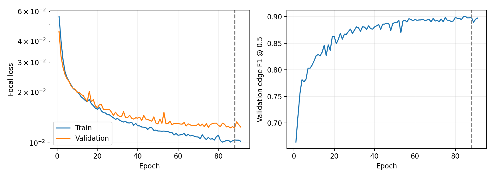

# 新no-time从头训练性能评估

模型保持原架构、原数据划分。训练随机初始化；已保存91轮，最低验证loss为第88轮。未发现100轮完成的元信息，不能按完整100轮报告。

固定两级阈值0.70/0.575；未添加Hough、时间约束恢复或双专家融合。合格真轨至少5hit，匹配要求纯度≥0.8、完整度≥0.5；假轨率和克隆率均以输出候选数为分母。

| 模型/数据组 | 真轨找回/总数 | 效率 | 假轨数/率 | 克隆数/率 |
|---|---:|---:|---:|---:|
| 旧no-time微调62轮：验证 | 42354/45165 | 93.7762% | 1958 / 4.4130% | 57 / 0.1285% |
| 新no-time从头88轮：验证 | 42257/45165 | 93.5614% | 2219 / 4.9832% | 54 / 0.1213% |
| 新no-time从头91轮：验证 | 42296/45165 | 93.6477% | 2047 / 4.6089% | 71 / 0.1599% |
| time33轮：验证 | 44628/45165 | 98.8110% | 805 / 1.7627% | 235 / 0.5146% |
| 新no-time从头88轮：测试 | 41777/44606 | 93.6578% | 2170 / 4.9328% | 44 / 0.1000% |
| time33轮：测试 | 44041/44606 | 98.7334% | 853 / 1.8907% | 221 / 0.4899% |

从头训练没有带来接近time模型的提升。它与旧微调模型的对照，未支持“旧权重初始化是主要瓶颈”的解释；但固定阈值可能受到概率校准影响，一次训练也不能证明空间信息或模型架构已达上限。

## 成对验证比较

下列区间按验证事件成对bootstrap 2000次计算，只描述这批验证样本的不确定性，不是独立重复训练的置信保证。

- scratch88_vs_finetune62：新找回779条、新丢失876条；效率差-0.2148个百分点，95%区间[-0.40679106382585045, -0.0243708580422384]。

- scratch91_vs_finetune62：新找回795条、新丢失853条；效率差-0.1284个百分点，95%区间[-0.3115419143612905, 0.06001901772209157]。

- scratch91_vs_scratch88：新找回625条、新丢失586条；效率差+0.0864个百分点，95%区间[-0.07342605987129798, 0.24108589881117487]。

- scratch88_vs_time33：新找回169条、新丢失2540条；效率差-5.2496个百分点，95%区间[-5.556207642500111, -4.939930039024377]。

## 真轨hit数分组

| hit数 | 第88轮验证效率 | 第91轮验证效率 | 第88轮测试效率 |
|---|---:|---:|---:|
| 5_6 | 78.50% | 79.44% | 83.51% |
| 7_10 | 94.56% | 94.61% | 94.78% |
| 11_20 | 93.60% | 93.75% | 93.37% |
| 21_plus | 26.01% | 26.44% | 21.22% |

## 建议

本次没有依据用新模型替换旧no-time主权重。time仍可作为当前效率优先的主模型，no-time保留作空间对照及互补候选；不能把两模型互补真轨数量直接当作可实现的融合收益。

若继续投入no-time，先在验证组检查阈值校准与较低学习率的受控续训，保存不同阶段权重并按整轨指标选模；暂不重复相同学习率的从头训练。任何后续配置变化均需冻结后再验收，不能据本次测试结果反复调参。

## 训练状态与限制

初始学习率0.001，至91轮仍为0.001；第88轮验证loss=0.01227297，尚未触发学习率衰减。不能据此宣布no-time架构或输入信息已达极限。

测试权重预先固定为验证loss最佳第88轮；第91轮仅做验证诊断，未根据测试结果选择。现有测试组此前已用于time模型验收，不是全新的外部数据。一次随机种子训练不足以把差异完全归因于初始化方式。

长轨hit数分组不是多圈/回散射物理标签；Good等真值筛选与未模拟完整电子学响应仍限制指标的实验外推。

最佳权重SHA256：fd017deedbd922efd93aae9c987e9f4dda97f39657dd6b1652c5b9026dd74046。末轮权重SHA256：7ba47897afb8b41c1e5b3b039155f28427cf0e77f73f04c57de1e44c6ecbc122。原训练脚本、原模型权重与数据均未修改。
