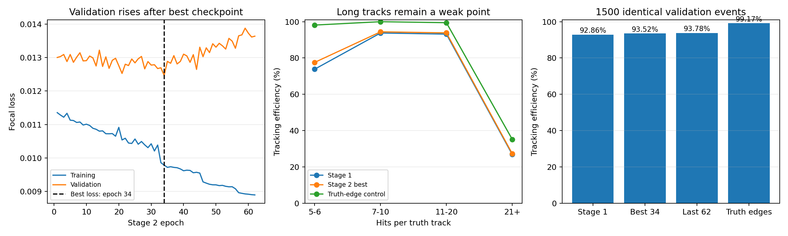

# 第二阶段no-time：两级寻迹评估与停滞诊断

2026-10-14。1500个验证事件，45165条至少5hit真轨；独立1500测试事件未评估。未继续训练或修改主权重、两级寻迹算法。

第二阶段不是完全无改善：最佳权重效率从92.864%提高到93.522%，增加0.658个百分点（净找回297条）。同事件成对bootstrap的95%区间为0.501～0.820个百分点；是验证组内的抽样区间，不是独立测试保证。

第62轮的寻迹效率反而更高，为93.776%；比第一阶段净多找回412条真轨。它的验证loss较差，所以没有成为主best文件；这是本次发现的训练选模目标与实际寻迹目标不一致。

## 相同两级流程的实测

固定0.70/0.575阈值，拟合RMS门槛1.0/1.5mm。真轨至少5hit，匹配要求纯度≥0.8、完整度≥0.5；假轨率和克隆率分母均为输出轨数。原始预训练模型在同一新验证组效率为74.945%。

| 权重/对照 | 寻迹效率 | 假轨率 | 克隆率 | 找回真轨 |
|---|---:|---:|---:|---:|
| 第一阶段loss最佳（77轮） | 92.864% | 5.106% | 0.185% | 41942/45165 |
| 第二阶段loss最佳（34轮） | 93.522% | 4.661% | 0.099% | 42239/45165 |
| 第二阶段末轮（62轮） | 93.776% | 4.413% | 0.128% | 42354/45165 |
| 真实连边诊断对照 | 99.165% | 0.894% | 0.951% | 44788/45165 |

真实连边对照把已有候选边的概率替换为真实标签；其余图、d和寻迹流程不变。它使用不可部署的真值信息，且全1边概率会改变排序、切树和层级拆分行为，因此是瓶颈诊断对照，不是数学意义上的最优效率上限。

## 第62轮为什么不如继续下降的训练loss那样乐观

主best权重与完整checkpoint中的best_model逐张量一致；重新推理验证loss=0.01246759，对应第34轮。第62轮训练loss=0.00889376、验证loss=0.01364051。训练拟合仍在改善而验证损失回升，证据支持过拟合；保存器保留34轮而非62轮是正常行为。

边F1@0.5：第一阶段89.703%、第二阶段最佳90.111%、第62轮90.047%。Focal loss、边F1和整条径迹指标不是同一目标；错误连边可合并两条轨，缺边可把轨迹打碎，随后还有拟合和hit冲突验收，不能从训练loss直接推出98%寻迹效率。

## 漏检位置

| 真轨hit数 | 数量 | 第一阶段 | 第二阶段最佳 | 真实连边对照 |
|---|---:|---:|---:|---:|
| 5_6 | 107 | 73.832% | 77.570% | 98.131% |
| 7_10 | 32965 | 93.763% | 94.409% | 99.985% |
| 11_20 | 11624 | 93.152% | 93.823% | 99.432% |
| 21_plus | 469 | 26.866% | 27.292% | 35.181% |

实际首级阈值0.70下，正边召回率34轮为72.953%、62轮为74.821%，精确率分别98.331%/97.876%。这解释了为什么62轮在loss和F1@0.5较差时，固定两级流程仍能找回更多轨迹：生产工作点的连通性变化与0.5分类评价不同。该统计说明工作点变化，并非逐条漏检的独立因果证明。

长轨虽差，但只占469/45165。即使单独补回所有长轨漏检、保持其他结果不变，总效率也只升到94.277%；因此不能把与旧98%的差距全部归因于长轨。

最佳模型漏检2926条，其中2603条在真实连边对照中恢复，323条两者都未恢复；另有54条仅对照失败。这一交叉统计同时说明连边和后处理的作用，也提醒不能将对照直接当上限。

真实连边下总体效率99.165%，说明当前图和两级流程能够接受绝大部分普通真轨，并没有统一卡在93%左右的几何门槛；主要改进空间在预测连边及其引起的组轨变化。长轨真实连边效率仍仅35.181%，同时存在后处理/几何瓶颈。真实标签不可观测，因此该结果不保证no-time网络一定能达到99%。

固定随机种子20261014抽取200个验证事件；以下为规则判别的失败表象，分类有先后顺序，不能当作相互独立的因果贡献。

| 漏检表象 | 条数 |
|---|---:|
| 完整度够但纯度不足 | 109 |
| 宽松连边仍碎成不足5hit | 161 |
| 严格阈值碎裂 | 53 |
| 与其他真轨连在一起 | 49 |
| 候选部分丢失 | 26 |
| 几何/候选拒绝 | 7 |

## 单圆拟合的独立检查

把同一条真轨的全部hit交给原拟合器，分别使用测量d和d_true，不删hit；这比生产寻迹中允许取片段、删最多2hit更严格，不能将失败比例直接等同实际寻迹漏检率。

| 已知真轨分组 | 真轨数 | RMS中位数mm | RMS>1.5mm |
|---|---:|---:|---:|
| 5_20:measured_sigma05 | 5887 | 0.3965 | 37 |
| 5_20:true_distance | 5887 | 0.0117 | 34 |
| 21_plus:measured_sigma05 | 62 | 4.6517 | 45 |
| 21_plus:true_distance | 62 | 4.6920 | 44 |

对5_20的34条d_true拟合失败轨，用线性圆估计给出新初值并尝试3个半径初值，有19条降到RMS≤1.5mm，原中位数2.1523mm，改初值后中位数1.2331mm。普通轨仅选抽样中前200条失败轨，长轨检查该抽样所有失败轨；不是代表性总体成功率，也不是模型/生产算法已修复。

对21_plus的44条d_true拟合失败轨，用线性圆估计给出新初值并尝试3个半径初值，有2条降到RMS≤1.5mm，原中位数9.2313mm，改初值后中位数8.8952mm。普通轨仅选抽样中前200条失败轨，长轨检查该抽样所有失败轨；不是代表性总体成功率，也不是模型/生产算法已修复。

同一hit、同一d_true，仅改优化初值有2条长轨通过门槛。仍不通过的轨迹不能据此认定为物理非圆，也可能还有左右漂移解、优化初值等问题；需进一步结合模拟坐标、动量演化核查。

更正说明：2026-10-14后续核查发现旧的真轨全hit拟合探针混用了float32坐标和float64距离，会改变数值差分行为，放大部分RMS。本节已用全float64重新计算，旧版的“62条长轨全部失败、19条因初值恢复”统计撤回。实际两级寻迹效率、假轨率、克隆率、真实连边对照以及漏检分类不受此探针问题影响；寻迹算法和权重均未修改。

## 为什么旧98%不能保证新数据98%

原STEP1默认每图也混合约30条粒子，旧源粒子在原点出生；新数据含离轴、管壁附近衰变。旧距离误差σ=0.075mm，新文件已添加σ=0.5mm；旧数据还执行300ns窗口和100ns每Cell死时间处理，新完整事件没有这些处理。旧完整度分母基于电子学处理后hit，新组基于保留的原始筛选hit。这些都是已核查的任务差异，不能只归因于“随机混合变成完整事件”。

此前核查旧源train/validation/test的EvtID集合互不相交，未发现用户担心的跨划分源粒子重用。因此旧98%不能被简单解释为题库泄漏，也不应据此保证新域必能达到98%。当前证据没有单独分配出生半径、误差、电子学和优化初值各自的因果贡献。

## 后续建议

同时保留第34轮与第62轮作为候选，先暂停继续加轮次。第62轮效率93.776%和假轨率4.413%在当前验证组优于34轮，但克隆率略高，不能仅凭验证loss回升就淘汰62轮。末轮权重只从完整checkpoint导出到诊断目录last_epoch_62.pth，主best文件仍是34轮。验证组校准两级阈值，并用整条径迹效率、假轨率和克隆率联合选择候选；阈值扫描和按寻迹指标选择训练checkpoint本次未实施。

对已经定位的碎裂、混轨和长轨分别改进并做固定事件的成对实验：连边侧检查困难正边和短轨的训练覆盖；后处理侧检查圆拟合初值、层级拆分与长轨片段恢复。若要改网络，再与相同新数据、相同预算的从头训练作对照；本次尚不足以判定网络容量已经达到极限。

当前Good、Axial、ExtendedDecayWithSpin筛选依赖真值，不含额外电子噪声；指标不能直接视为完整实验读出性能。没有评估time模型，没有在独立测试组调参或验收。

