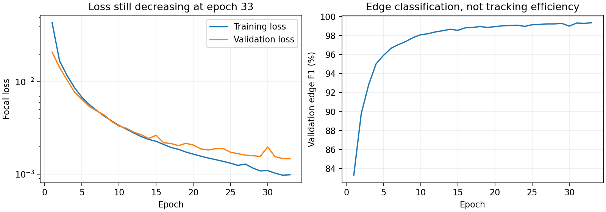
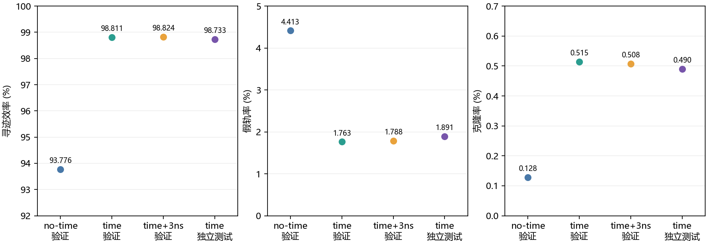

# 第33轮 time 模型：是否续训与本地验收

> 历史模拟报告：2026-10-15补充反馈给出TTC约100ps参考、外推时间误差约5ns以内，且确认TTC需寻迹后关联。时间算法保留研究价值；首轮输入等价性与关联后精修效果尚待验证。本文数值不变，适用结论见[最新测量说明](../../docs/MEASUREMENT_UPDATE_20261015.md)。

结论：建议本轮先不继续云端训练，将第33轮作为本地候选，优先处理长轨、分段输出与克隆。该判断在独立测试前已记录；不是充分收敛或继续训练无收益的证明。

## 训练是否收敛

已完成33/100轮，最佳loss轮为33。第20到33轮验证loss由0.00206降到0.00146，约下降29%，学习率尚未衰减。因此不能说已达到训练极限。现有模型的重建收益已经明显，剩余误差集中在长轨、完整度不足与克隆，继续同样数据训练未必能解决这些问题；保留完整断点供后续受控续训。



## 相同两级寻迹框架的结果

阈值固定0.70/0.575，未叠加片段延长、合并或Hough。合格真轨≥5hit；匹配纯度≥0.8且完整度≥0.5。效率分母为合格真轨；假轨率和克隆率分母均为全部输出候选。98%以上效率不表示每条径迹全部hit都已回收。

| 模型/数据组 | 事件 | 真轨总数 | 找回 | 效率 | 假轨数/率 | 克隆数/率 |
|---|---:|---:|---:|---:|---:|---:|
| no-time62 验证 | 1500 | 45165 | 42354 | 93.7762% | 1958 / 4.4130% | 57 / 0.1285% |
| time33 验证 | 1500 | 45165 | 44628 | 98.8110% | 805 / 1.7627% | 235 / 0.5146% |
| time33 验证+3ns | 1500 | 45165 | 44634 | 98.8243% | 817 / 1.7884% | 232 / 0.5078% |
| time33 独立测试 | 1500 | 44606 | 44041 | 98.7334% | 853 / 1.8907% | 221 / 0.4899% |

time相对no-time在同一验证组效率提高5.035个百分点；新找回2432条，同时新增漏掉158条，净增2274条。克隆率上升，不能称所有指标均改善。



## 3 ns敏感性

在同一1500验证事件加入逐hit独立高斯3 ns信号时间抖动，并重算全部时间特征。时间扰动随机种子固定20261015，模型、几何、d与阈值不变。匹配集合新找回17条、新漏掉11条；净变化很小，不能将加噪后的微小增加解释为加噪带来稳定收益。独立测试只验收原输入，未做独立测试组的加噪扫描。

这不是完整双TDC响应：参考误差共享范围、与d的相关性仍未标定。

## 不同hit数量

| hit数量 | 验证真轨 | 验证找回 | 验证效率 | 独立测试效率 |
|---|---:|---:|---:|---:|
| 5_6 | 107 | 99 | 92.52% | 92.78% |
| 7_10 | 32965 | 32816 | 99.55% | 99.52% |
| 11_20 | 11624 | 11538 | 99.26% | 99.21% |
| 21_plus | 469 | 175 | 37.31% | 29.80% |

验证组漏检537条，其中≥21hit组漏掉294条。高hit数不能单独证明多圈或回散射，但这一分组与现有单圆拟合限制值得优先检查。

验证假轨805条中，混轨候选111条，纯度足够但完整度不足候选694条。空间专家仍有158条time未匹配的真轨，提示后续融合可能互补；本报告未运行或宣称MoE/双专家融合效果。

## 三个已讨论事件

| EvtID / TrkID | time33原流程是否匹配 |
|---|---|
| 174 / 1637 | 是 |
| 177 / 4532 | 否 |
| 188 / 3769 | 否 |

图片与圆参数JSON保存在工具目录 time_model_epoch33/event_gallery/index.html。

## 本地模型与复现

模型已安装到 `whole_event_retraining/best_interaction_network_time_expert_whole_events_sigma05.pth`，元信息同目录 `model_metadata_time_expert_whole_events_sigma05.json`。原始time/no-time初始化权重未覆盖。云端完整断点归档为本目录cloud_epoch33_training_state.pth；其Linux路径与数据mtime签名未迁移，不能直接当Windows续训断点。

```powershell
python STEP4_两级寻迹.py --features time --dataset-root whole_event_retraining --run-tag expert_whole_events_sigma05 --split validation --rounds 1500 --strict-threshold 0.70 --relaxed-threshold 0.575 --output whole_event_retraining/time_expert_assessment/local_rerun.json
```

固定模型SHA256：`354747c584cdba0aa5ab019044cdcc29cc0b23562b0c1673fbd12b97591b39c8`。评估代码在工具目录assess_time33.py，核查笔记本time_model_epoch33/评估核查.ipynb。未对独立测试结果选阈值、改模型或重新训练。独立测试结果只对应此权重、此输入分布和匹配口径；真实噪声/完整电子学响应尚未验收。
