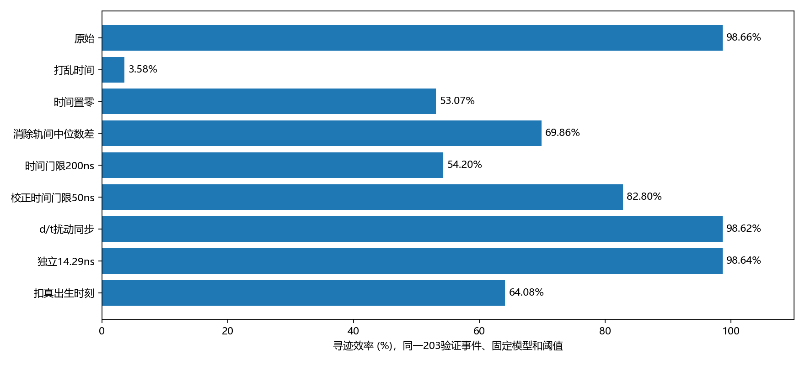

# time模型作弊与时间捷径核查

> 历史模拟报告：2026-10-15新增实验反馈确认精确模拟时间不可直接取得。本文数值不变，time及时间回收仅作理想时间对照；适用结论以[测量口径更新](../../docs/MEASUREMENT_UPDATE_20261015.md)为准。

结论：未发现直接标签/真值输入泄漏或跨划分的精确重复测量事件。模型明显依赖模拟中强烈的轨间时间差；当前高效率不能直接外推到时间口径未知的真实读出。另有d已加误差、t未同步模拟响应的口径风险，需要按实际电子学统一建模。

## 实测对照

固定第33轮权重与0.70/0.575两级阈值，不训练、不调阈值。使用此前已固定的203个验证事件，共6035条合格真轨；不是新增测试集。真轨≥5hit、匹配纯度≥0.8且完整度≥0.5；假轨/克隆分母是输出候选。

| 对照 | 找回真轨 | 寻迹效率 | 假轨率 | 克隆率 | 边F1@0.5 |
|---|---:|---:|---:|---:|---:|
| 原始time33 | 5954/6035 | 98.66% | 1.85% | 0.48% | 99.14% |
| 事件内随机打乱时间 | 216/6035 | 3.58% | 56.71% | 0.00% | 26.13% |
| 全部时间置零 | 3203/6035 | 53.07% | 26.17% | 0.16% | 65.63% |
| 消除真轨时间中位数差（真值诊断） | 4216/6035 | 69.86% | 18.19% | 0.12% | 76.29% |
| 仅时间门限 \|Δt\|≤200ns，无神经网络 | 3271/6035 | 54.20% | 1.08% | 0.66% | 86.99% |
| 仅校正时间门限 \|Δ(t−d/v)\|≤50ns，无神经网络 | 4997/6035 | 82.80% | 1.02% | 0.77% | 96.04% |
| 把d的测量扰动同步到t（响应一致性诊断） | 5952/6035 | 98.62% | 1.95% | 0.46% | 99.18% |
| 逐hit独立时间σ=14.29ns | 5953/6035 | 98.64% | 1.77% | 0.46% | 99.05% |
| 扣除各粒子真出生时刻（真值诊断） | 3867/6035 | 64.08% | 21.04% | 0.20% | 72.00% |

同一203事件的既有逐hit独立3ns对照：效率98.72%，假轨率1.84%，克隆率0.46%。单一随机种子。该信号时间扰动不是完整双TDC/公共参考响应，也不能在未标定时把合并的漂移时间3ns直接等同单路信号TDC误差。

随机打乱、置零与扣真出生时刻会破坏训练分布；它们说明当前模型依赖哪些信息，不能作为在新口径下重新训练模型的性能上限。真轨中位数/出生时刻仅用于离线诊断，绝不能接入线上特征。简单时间门限仍沿用空间候选图和几何两级组轨，因此不是完全不看几何的寻迹器；门限预先固定，没有扫描择优。

## 排查直接泄漏

- 节点只有丝位置/半径、测量d、方位角三角函数及事件内相对信号时间。边只有几何差和时间差。候选图只按丝位置建立。
- 神经网络forward仅接收x、edge_index、edge_attr；标签y仅参与训练损失与评价。EvtID、TrkID、t0、tHit、d_true未进入网络。两级组轨也不依赖真轨标签，真轨关联在evaluate中完成。
- CPU上篡改y、真轨ID、事件ID，预测逐值不变。节点重排后GPU最大预测差5.36e-07，符合浮点累加次序影响，未发现依靠行号/排序识别真轨的证据。
- 从原CSV重新生成10个验证事件，输入、候选边、标签与已保存图逐值一致；将TrkID改成每hit不同后，标签改变而输入及候选边完全不变。
- 核查全部10000个图：7000/1500/1500事件ID划分完整、互斥；跨划分精确测量事件重复0，精确测量轨迹签名重复0。
- 原CSV的NativeEvtID+SourceShard、PoolEvtID在10000事件间重用数分别为0、0。精确签名检查不能排除重新加噪/近重复生成，未对缺失的primaries.root做上游重复审计。

## 时间为什么如此有用

1500验证事件信号时间跨度中位数为8.97μs；单条真轨hit时间跨度中位数为140.7ns。203事件中相邻真出生时刻差中位数为136.7ns。

在空间候选边上，同轨|Δt|中位数为50.5ns，异轨为1632.8ns。使用可观测量t−d/0.035后，同轨差中位数为13.4ns，异轨为1634.5ns。这种分离使连边分类比纯几何容易得多。

3ns是测时误差假设，不能用它否定百纳秒到微秒尺度的分轨信息，也不能把这种粗时间分轨误称为分辨几十ps的hit先后顺序。

第33轮time是从已有time权重微调，并非从零训练33轮；日志微调前边F1为0.1296，第1轮为0.8331，第33轮为0.9934。轮数与新no-time的从零训练不是相同起点，快收敛本身不能证明作弊。

## 响应口径风险

当前CSV中t−tHit−d_true/0.035的绝对残差中位数0.0074ns，99%分位0.0317ns。该关系与本地CDCSD源码signalTime=hitTime+driftDistance/v一致；没有证据表明CSV已加入3ns独立高斯时间扰动。少数残差可能与同丝hit聚合等有关，不能把残差当作实际TDC分辨率。

d则已独立加入σ=0.5mm误差。若实际d由同一TDC漂移时间换算，d与t应相关，不能把d和t当独立测量随意加噪。3ns×0.035mm/ns=0.105mm，而0.5mm/0.035mm/ns=14.29ns，两者不等价；额外误差来源和协方差尚待标定。

响应一致性诊断使用t′=t+(d−d_true)/v，让相同d扰动反映到信号时间；它不宣称实际时间分辨率就是14.29ns，也不替代完整双TDC、扩散及参考共模模型。独立14.29ns对照用于区分扰动幅度与相关性；这些都是固定模型的敏感性，不是重训后的性能。

原数据使用Good==True、Axial、ExtendedDecayWithSpin真值筛选，并保留整个模拟事件；没有额外注入背景噪声或执行原AI4的300ns窗口/100ns死时间。模拟器本身已有同丝hit聚合逻辑，不能说完全没有任何响应处理。Good与过程筛选并非实际未知hit集合中可直接使用的在线信息。这些限制同时影响time和no-time，属于任务口径，不是time网络单独读取标签。

## 更关键的联合可观测性

本数据的t−d/v近似恢复hitTime，而hitTime含不同粒子的出生时刻。d是模拟几何真距离加噪声，未演示现实中如何在尚未分轨时得到每个hit的正确漂移距离。如果真实d由同一t减一个全事件共同参考t_ref换算，在近似线性v下t−d/v会接近t_ref，不能自动获得这里逐轨不同的时间标签。若存在已测量并已关联的逐hit/逐轨参考或独立距离信息，则可能合法；本次尚未确认。

因此，是否把(d,t)看成可同时获取的输入，比单独是否增加3ns更关键。同步d/t扰动仅改变噪声相关性，仍保留原模拟的轨间出生时间差，不能证明真实系统能获取这对输入。

## 两种实际输入情况

1. 保留共同参考下的绝对信号时间，并能独立获得模型所需的每hit漂移距离：跨粒子到达时间差属于合法信息，当前结果在此模拟任务上可成立；仍需匹配采集窗、通道偏移、3ns误差、d/t相关性及噪声/死时间。减去一个全事件共同触发时刻不会抹去轨间时间差。

2. 只有纯漂移时间，或读出窗与当前9μs事件不一致：当前结果不能直接沿用。扣每粒子真t0的实验只是移除粗轨间时间差的诊断，真实参考不等于真t0。短窗口必须重新构造窗口内事件、重新定义真轨分母和训练/验收；不能把纯漂移时间与短窗简单视为相同条件。

建议保留现有模型作为模拟基线；先确认t和d如何测得、参考时刻如何匹配，再统一d/t响应并重建独立验收数据。不要只因98%就淘汰模型，也不要据此承诺真实实验效率。针对同一漂移时间任务重新训练、真实电子学/噪声建模和上游原始初态重复核查，本次未实施。

## 复核文件

权重SHA256：354747c584cdba0aa5ab019044cdcc29cc0b23562b0c1673fbd12b97591b39c8。审计脚本：AI4.1/tools/audit_time_leakage.py。原权重、原数据、训练/寻迹代码均未修改。

本地源码用于解释机制；本次没有逐项核验生产二进制与该源码的构建提交一致。关键t关系另由原CSV实测支持。
