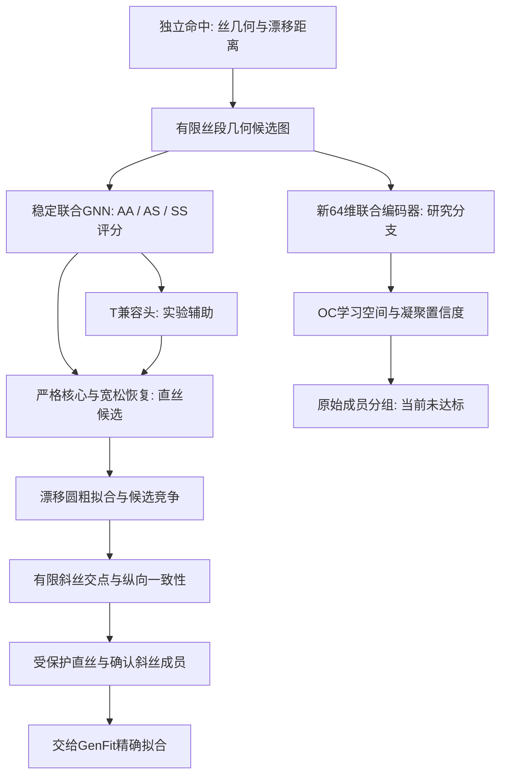

# AI6直丝—斜丝联合寻迹研究交接

交接时间：2026-11-24。代码和权重覆盖稳定、未成熟、失败和暂停的路线；“已归档”不表示“推荐部署”。项目原始Windows工作区为 `D:\pycharm\root操作\AI工程化6`，本仓库对应目录为 `AI工程化6/`。

## 阅读顺序

- [RESULTS.md](RESULTS.md)：各路线效果、分母和可比性。
- [REPRODUCTION.md](REPRODUCTION.md)：数据、权重、入口、路径与运行限制。
- [REFERENCES.md](REFERENCES.md)：原始文献与本项目适配边界。
- [MODEL_CATALOG.json](MODEL_CATALOG.json)：本次完整权重路径、大小与SHA256。
- [LOCAL_FILE_INVENTORY.json](LOCAL_FILE_INVENTORY.json)、[CLOUD_FILE_INVENTORY.json](CLOUD_FILE_INVENTORY.json)：来源清单；[EXCLUDED_REGENERABLE_FILES.json](EXCLUDED_REGENERABLE_FILES.json)列出未打包的非代码/非模型派生数据。

## 基本原理

### 观测和候选图

节点是独立HitID，观测包含丝几何、漂移距离、丝层类型和有符号倾角。正式AI6用12维节点、12维边特征，在两根有限丝的共同z范围内寻找横向最小间距，以≤120mm构建宽松双向候选图。直丝和斜丝共同参与消息传递；不把斜丝中点当成实际三维命中。

真值同轨关系产生AA/AS/SS边标签。推理不读取真值，也不根据真轨预先拆事件。原始数据固定7000训练/1500验证/1500测试；后续开发曾多次查看部分验证/测试事件，应按各报告披露使用背景。

### 稳定GNN与两级提取

旧联合Interaction Network使用256宽消息MLP、12维残差节点状态、7次节点更新和最后边分类；按AA/AS/SS选择输出。稳定第126轮权重及其冻结候选校准器组成可复现快照。

严格阈值先构造高置信直丝候选，宽松阶段恢复残余命中/片段。漂移圆二维粗拟合判断候选是否合理，竞争/冲突分配减少串轨和克隆。通过AS/SS及有限丝几何附着斜丝，粗三维利用斜丝与R及R±d圆柱面的交点、纵向一致性和有限z约束。保留已正确找到的直丝；斜丝可舍弃一部分，只保留可靠成员交给GenFit。

### E与T两条局部研究路线

E将同CellID的独立命中保留为一个候选族的多个观测，束边预测普通/二重/多重支持，再展开通道和配对。颜色/重数分类无法单独保证底层hit配对正确，当前不推荐替换稳定流程。

T判断共享中心的两条候选边能否同轨解释。T25头59,233参数；最初冻结主干，以中间节点/边特征训练。兼容边图与几何提取有小幅内部确认收益，但原实现最终转为hit集合和贪心分配，可能丢失路径条件信息并过早锁点。路径状态beam、弱连接加权、空间补边等负结果全部保留。

### OC径迹归属研究

新Membership模型原始观测12维另编码为64维节点状态，消息宽256，额外输出3维学习空间坐标和凝聚置信度β。同轨吸引、异轨排斥、中心置信度与边/T辅助监督共同反传，直接学习径迹成员，不需要事先指定轨数。学习空间不是物理XYZ。

当前OC-v1是本项目适配实现：`q=atanh(beta)^2+0.1`，真轨内最高β命中为训练中心，平方距离吸引、单位半径hinge排斥和置信度项；推理通过β、中心抑制和半径关联。它不是完整CAT Finder复现，也没有其TDC/ADC输入、运动学回归或全部训练细节。

## 路线与文件地图

|方向|主要文件/目录|状态|
|---|---|---|
|稳定联合GNN|`common.py`、`STEP1_生成AI6数据集.py`、`STEP2_训练模型.py`、`STEP3_推理评估.py`|已训练，保留126轮快照|
|两级与粗三维|`STEP4_联合寻迹推理.py`、`STEP5_两级寻迹.py`、`two_stage_core.py`、`coarse_3d_membership.py`、`STEP18_粗三维寻迹与GenFit导出.py`|有实际评价，精拟合另交GenFit|
|图分片/恢复|`graph_cache.py`、`server_runtime.py`、`slurm_training_watchdog.py`|需按具体试验恢复契约|
|E/T头与提取|`experiments/双路线寻迹_20261122/`|T25小幅收益，E未成熟|
|路径状态与接口微调|`experiments/三元组路径状态_20261122/`|未超过稳定T方案|
|Kmeans/短段补边|`experiments/空间片段补边可行性_20261122/`|候选纯度/上限诊断，不是实际寻迹效率|
|OC架构/损失/加速|`experiments/联合归属训练_20261123/`|已试训/扩量，原配置暂停|
|最新OC判断|`experiments/联合归属训练_20261123/review_20261124/`|9轮完成，第10轮部分；不自动续训|
|云端完整各轮权重|`cloud_artifacts/`|包括E/T、课程微调、OC、优化器断点与运行元数据|
|受保护历史源码|`protected_baselines/`（若有）|原备份来源，不覆盖主目录|

## 当前问题与研究分工

1. 高空间重叠和同丝多命中区容易分裂；共享主干与分支的关键接口可能低分。检查过的代表事件已有真边连通性，不等于全部事件候选图都充分。
2. BCE/边分类损失平均对普通冗余边与关键桥边区别不足。提高正例惩罚曾主要抬升分数尺度，未带来稳定整轨收益。
3. 三元组兼容标签只表示三点同轨，不能替代盘绕轨的有序路径；全局半径单调或VELO的z层序不能直接搬到CDC。
4. OC损失下降但原始成员效率停滞/退化；中心提取、β、负例归约、表征与主任务梯度仍需归因。仅增强近邻排斥的尝试没有胜出。
5. 训练速度受CPU采样/分片I/O、分块过小和重算影响。向量化损失、micro4、chunk16384、部分重算和1/2 worker已实测；更换节点后仍要检查等待比例。

建议一条研究线负责训练目标/嵌入/表示，一条负责提取/几何/克隆抑制。两线固定相同事件、输入和评价分母，分别保存找回与损失径迹；共同复核后再组合。GenFit参数精拟合不在当前成员归属指标内。

## 可视化入口与现有图片

六面板漏轨诊断入口为 `STEP19_六联图可视化诊断.py`（以实际文件清单为准）；`visual_diagnosis_20261121/`保存既有输出。真值颜色仅用于离线诊断；紫红圈/箭头表示漏轨，黑叉表示未分配命中，不能把两者混为一谈。

重点阅读：

- [稳定粗三维报告](../joint_training/local_evaluation_epoch126_20261107/coarse_3d_v4_fast_report/粗三维斜丝选点与GenFit交接.md)。
- [T25确认报告及图](../experiments/双路线寻迹_20261122/confirmation_20261122/确认集评估报告.md)。
- [OC最新复核及图](../experiments/联合归属训练_20261123/review_20261124/全量阶段复核与续训判断.md)。

## 可交付范围

包括成熟与未成熟项目代码、全部找到的神经网络权重/优化器断点、源数据NPZ及几何、报告和图片。重建图缓存、冻结中间表示、重复zip及大型逐命中数组等非代码派生文件按清单排除，必要时按原脚本再生成。没有隐藏失败试验；也没有将训练计划写成已完成结果。
