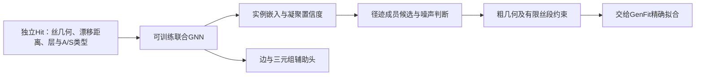

# 下一代寻迹主路线：联合表征与径迹实例归属

这是根据已有实验和原始论文提出的研究方案，尚未实现或验证新模型的效果。本次未启动新训练。

## 判断

局部接口补边保留为诊断和兜底。下一代主路线应让直丝、斜丝的联合表示直接学习“哪些独立观测属于同一条径迹”，并将边与三元组任务作为辅助监督。精确拟合仍交给GenFit，粗几何用于质量检查和歧义判别。

## 已验证事实与尚未证明的假设

1. 四个代表事件中，0.4候选图已有足够纯真边匹配连通性，12条在0.575下碎裂；仅增加候选数量不是这批问题的充分解。
2. 弱连接加权微调主要造成分数尺度变化。校准后的新头在后续200例确认中配旧提取器净少2条，未证实成员收益；配路径状态原型净少35条。
3. 当前common.py中消息网络宽度256，但节点更新输出为12维，且x+x_update仍为12维。THead将此状态投影至32维，不能据此恢复未编码的信息。节点状态容量是否构成实际瓶颈，尚需消融验证，不能仅看维度断定。
4. 最近两条路线冻结了原主干，只训练E/T头，因而不能用最终命中归属目标更新主干表示。当前T标签主要为三点是否同轨，不等价于有序路径中的正确下一步。

## 相关原始研究

- [ETX4VELO，2406.12869v3，§§3.2–3.4](https://arxiv.org/html/2406.12869v3)：边与三元组分类联合训练GNN，节点与边都有学习表示。其探测器提供直接3D坐标且有前向平面次序，不能直接移植该方向约束到CDC。
- [Belle II CAT Finder，2411.13596v2，§6.3](https://arxiv.org/html/2411.13596v2)：对中央漂移室wire hits使用学习空间和Object Condensation，生成可变数量径迹并关联命中。论文输入含TDC/ADC，与本项目仅使用几何/漂移距离的设置不同；不引用其效率作为本项目预期。
- [Object Condensation原始研究](https://arxiv.org/abs/2002.03605)：学习实例聚类空间和凝聚置信度的通用方法。

## 建议架构

- 原始12维物理输入保持独立，另编码为64或128维可训练节点状态；原256宽消息与8轮设置作为参照。先分开检验节点状态宽度、消息次数和聚合方式，避免同时改变全部变量。
- 保留AA/AS/SS几何信息，探索按边类型归一化聚合或有门控的消息传递，检验密集斜丝邻域是否淹没稀疏直丝接口证据。此处是待验证假设。
- 每个独立HitID输出学习空间坐标、实例中心/凝聚置信度及可选噪声分数。学习空间坐标不是实际XYZ；不引入真实hit位置、时间或其他不可用观测。
- 实例数量由凝聚候选决定，不预先设置轨数K。相同CellID的独立HitID保持为不同节点，不先合并。若现实中一个读出观测确实混合多轨，需要另外定义歧义标签及关联协议。
- 同轨命中在学习空间中趋近，空间邻近但异轨的命中分离。这样即使某条局部边低分，也存在从整条径迹实例证据恢复成员关系的途径；不保证所有缺边或不可辨识观测都可恢复。
- 首版只优化成员分组，不照搬论文的动量、起点、荷电回归头。普通边和三元组头用于局部一致性，实例目标负责整体分组，减少对单个接口阈值的依赖。

## 训练目标需要同步改变

1. 从完整观测图端到端训练，不能继续用冻结中间h/latent缓存训练新主干。原始事件、几何与候选图可缓存；中间表示必须随模型重算。
2. 按径迹、按A/S类型归一化损失，防止长轨、密集段或数量更多的斜丝贡献支配梯度。
3. 用真值仅在训练时标记断开同轨片段之间的关键正连接；与附近不同轨迹的候选延续做局部排序/对比。不能只要求所有同轨冗余边统一涨分。
4. 同CellID/近邻区的异轨命中是重点难负例；这些与关键正接口一起训练，减少简单加重正例造成的整体抬分。
5. 凝聚/实例损失同时约束同轨聚合、异轨分离、中心选择和噪声。是否采用完整OC或先用更简单的度量学习，以开发试验为准。
6. 高重叠、多命中和短轨保留并分别评价。可以先用简单事件暖启动，再混入难例训练，但不把难例从最终评价删除。

## 最小消融顺序

|组|编码器/训练|成员输出|回答的问题|
|---|---|---|---|
|A|旧稳定模型|旧T25提取器|稳定参照，无需重新训练|
|B|旧结构，允许主干更新，边与T联合监督|固定旧提取方案|冻结主干是否限制了改进|
|C|64/128维节点状态的联合编码器|边与T头＋固定提取|丰富表示是否有额外价值|
|D|与C相同编码器|实例归属/OC主头，边与T作辅助|直接监督成员关系是否减少碎裂|

优先完成B的短周期对照和C/D共享编码器的设计；以D为下一代主路线，B/C用于定位收益来源。不要第一轮同时引入动态建图、全局Transformer和复杂路径优化。已有候选覆盖证据表明动态补图暂不是首要变量。

不预先规定必须更大模型；先做64/128节点状态对照并实际统计参数、峰值显存和吞吐。边数与训练激活往往比权重文件大小更影响显存。模型训练的小批软件检查与最终收敛训练分开，不能按10轮无收益推断全新架构无效，也不能直接照搬其他论文轮数。

## 成功标准

使用固定训练/开发划分，以及重新生成、从未参与本轮决策的确认事例。近期反复查看的多个200/500例集合保留为回归集，不再当作新模型盲测。

主指标为固定可重建性定义下的直丝效率、假轨率、克隆率、原正确直丝保留和粗三维有效种子；单列高重叠、低命中、长弧和密集事例。辅助记录接口连通性、实例拆裂/合并次数、聚类空间邻近真/假可分性及实际CPU/GPU总耗时。

不以边AUC、训练loss或已知真值模板的上限代替寻迹结果。OC仍有中心/半径等解码参数，也会产生错分、漏分、克隆；它需要正常的开发集校准与独立验证。

局部接口层可用于检查失败位置和候选上限，原两级寻迹保留为稳定基线。是否采用新模型以同事件、同输入、同评价口径的成员结果决定。
